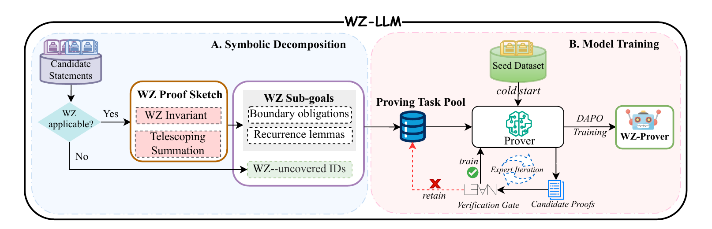

# WZ-LLM: Automated Formal Proofs of Combinatorial Identities via Wilf–Zeilberger Guidance and LLMs

<p align="center">
  <a href="https://arxiv.org/abs/2605.04472"></a>
  <a href="https://icml.cc/virtual/2026/poster/xxxx"></a>
  <a href="https://github.com/BeibeiX0/WZ-LLM/blob/main/LICENSE"></a>
  <a href="https://leanprover-community.github.io/"></a>
  <a href="https://github.com/BeibeiX0/LCIBench"></a>
</p>

<p align="center">
  
</p>

## 📖 Overview

**WZ-LLM** is a neuro-symbolic framework that integrates the classical Wilf–Zeilberger (WZ) method with large language models (LLMs) to automate formal proofs of combinatorial identities in Lean 4. Our approach bridges the gap between symbolic computation and neural theorem proving through *executable proof sketches* — WZ-derived proof plans compiled into Lean-checkable subgoals that guide an LLM-based prover.

### 🔑 Key Contributions

- **WZ-Sketch**: A symbolic decomposition engine (built on SageMath/CAS) that converts WZ certificates into structured, Lean-compilable proof sketches with well-defined subgoals.
- **WZ-Prover**: A specialized 8B-parameter prover trained via cold-start SFT on expert-verified seed proofs, bootstrapped iteration, and DAPO reinforcement learning refinement.
- **Two-Route Solving**: A hybrid strategy combining a sketch-guided route (for WZ-covered identities) and a direct route (for WZ-uncovered identities).
- **[LCIBench](https://github.com/BeibeiX0/LCIBench) (LCI-Test in the paper)**: A benchmark of 100 combinatorial identities formalized in Lean 4, spanning summation, product, and q-series identities. The benchmark is now publicly available, with standalone Lean theorem files, JSONL data, and evaluation instructions.

## 🛠️ Installation

### Requirements

- Python >= 3.10
- Lean 4 (v4.x)
- SageMath >= 10.0
- CUDA >= 12.1 (for training/inference)

### Setup

```bash
git clone https://github.com/BeibeiX0/WZ-LLM.git
cd WZ-LLM

# Create conda environment
conda create -n wzlm python=3.10 -y
conda activate wzlm

# Install dependencies
pip install -r requirements.txt

# Setup Lean 4 environment
cd lean_project
lake build
cd ..
```

## 🚀 Quick Start

> Coming soon. Code is being finalized and tested.

<!-- TODO: Add quick start examples -->

## 📁 Project Structure

```
WZ-LLM/
├── wz_sketch/          # WZ-Sketch: symbolic decomposition & proof sketch generation
├── wz_prover/          # WZ-Prover: LLM-based prover (training & inference)
├── lean_project/       # Lean 4 formalization & verification
├── benchmarks/         # LCI-Test, CombiBench, PutnamBench-Comb
├── data/               # Training data & WZ certificates
├── scripts/            # Training & evaluation scripts
└── configs/            # Configuration files
```

## 📝 Citation

If you find this work useful, please cite our paper:

```bibtex
@inproceedings{xiong2026wzlm,
  title={Automated Formal Proofs of Combinatorial Identities via Wilf--Zeilberger Guidance and LLMs},
  author={Xiong, Beibei and Lv, Hangyu and Liu, Junqi and Wang, Yisen and Chen, Shaoshi and Wang, Jianlin and Yang, Zhengfeng and Zhi, Lihong},
  booktitle={Proceedings of the 43rd International Conference on Machine Learning (ICML)},
  year={2026}
}
```

## 🙏 Acknowledgements

We thank the Lean community and Mathlib contributors for their foundational work on formal mathematics. We also acknowledge the developers of SageMath for providing robust symbolic computation tools essential to our WZ-Sketch pipeline.

## 📄 License

This project is licensed under the MIT License - see the [LICENSE](LICENSE) file for details.
